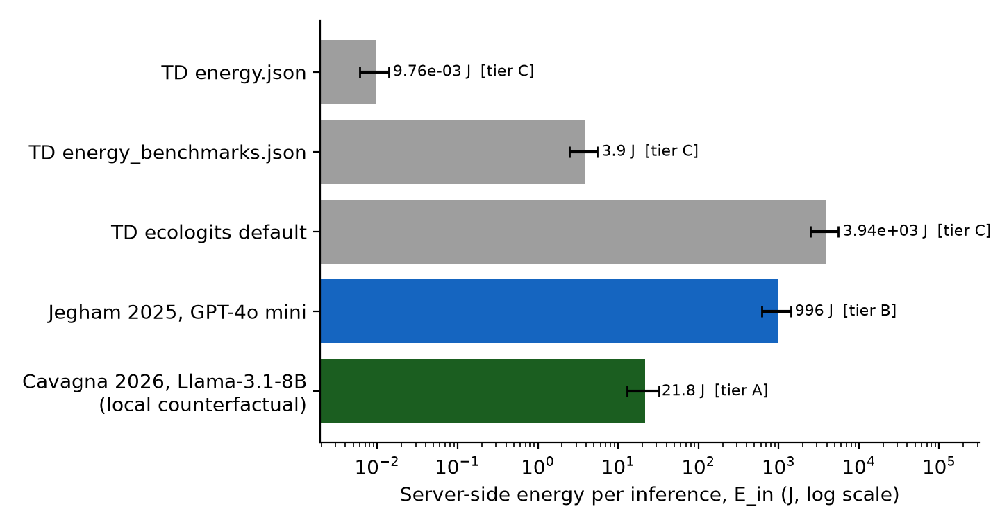
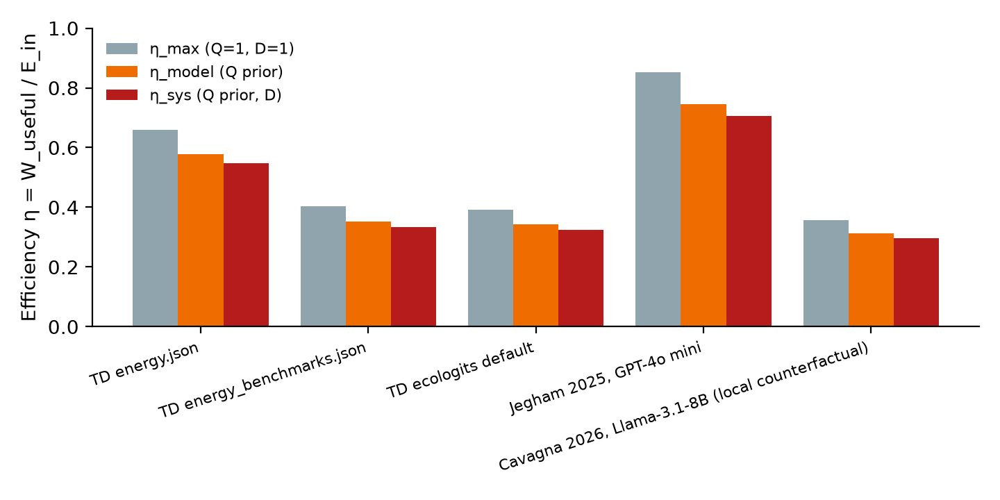
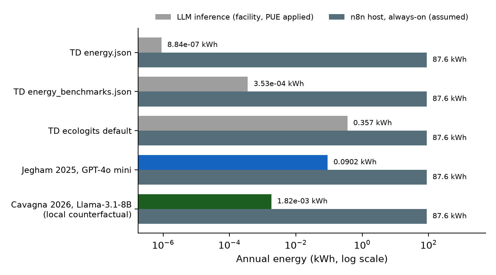
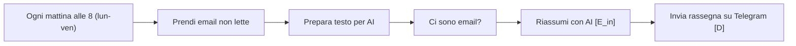

# Where the Joules Go in a Morning Email Digest: A Quality-Adjusted Thermal and Energy Efficiency Audit of an n8n LLM Workflow

Centrale73, ThermDash project
Terrebonne, Québec, Canada
Working paper, 27 October 2026. Code: `Centrale73/ThermDash`, branch `feature/n8n-thermaudit`, package `token_dashboard/n8n_audit/`.

---

## Abstract

Low-code automation platforms such as n8n make it easy to put a large language model (LLM) inside a scheduled business process. They do not tell the operator how much energy each run consumes, how much of it does useful work, or where the heat ends up. We present n8n-thermaudit, a program that combines the static workflow scanner of ThermDash-AutoAudit with ThermDash's quality-adjusted efficiency model, \(\eta = W_{useful}/E_{in}\) with \(W_{useful} = Q\,E_{out}\). We extend that model with a delivery gate \(D\), a temporal coverage metric \(K\) and an orchestration-host boundary.

We apply it to a published Italian template that summarises unread Gmail messages with gpt-4o-mini every weekday at 08:00 and sends the digest to Telegram. A Monte Carlo token model built from the workflow's own rendering code gives 831 input and 143 output tokens per run (p5–p95: 520–1176 input). Five energy-constant sets, including three that ship inside ThermDash, put the energy per inference anywhere from 0.0098 J to 3,940 J, a spread of 5.6 orders of magnitude. Over the same five sets, η_max ranges only from 0.36 to 0.85.

The headline tier-B estimate (Jegham et al., GPT-4o mini on DGX A100) gives 996 J per inference, 0.090 kWh, 0.32 MJ of rejected heat and 34 g CO2 per year, at an API cost of $0.055 per year, 48 times below the template's own "about one cent per day" claim. Three findings dominate the efficiency, ahead of any choice of model:

1. The delivery node still contains a placeholder chat ID, so the as-shipped \(\eta_{sys}\) is exactly 0.
2. The look-back window leaves 28.7% of the year unread (K = 71.3%).
3. An always-on 10 W orchestration host would use about 970 times more energy than the inference it orchestrates.

We argue that η, as defined, is a prefill/decode allocation ratio rather than a thermodynamic efficiency. Designs should be compared on joules per useful item.

**Keywords:** LLM inference energy; workflow automation; n8n; quality-adjusted efficiency; prefill and decode; heat rejection; PUE; system boundary; GDPR; energy auditing

---

## 1. Introduction

Most published LLM energy work measures a model on a GPU under a benchmark load. Operators, by contrast, rarely run "a model". They run a workflow: a trigger, a few data-shaping steps, one or more inference calls and a delivery step, repeated hundreds of times a year. Whether that workflow is energy-efficient depends on the model's joules per token, and just as much on how many tokens the workflow sends, how often it fires, whether the output arrives, and what else must stay powered for it to run.

ThermDash already defines a quality-adjusted efficiency for single LLM calls. Its companion project, ThermDash-AutoAudit, scans n8n workflow exports for governance and "waste" patterns. Until now the two did not connect: the scanner had no energy model, and the energy model had no notion of a workflow.

This paper makes three contributions:

1. **A program**, n8n-thermaudit, merged into ThermDash as `token_dashboard/n8n_audit/`. It reads an n8n export, finds the inference sites, derives a token model from the workflow's own prompt and shaping code, and propagates five energy-constant sets through a Monte Carlo simulation to per-run, annual, thermal, carbon and cost results.
2. **Three extensions to the efficiency model:** a delivery gate \(D\), a coverage metric \(K\) that is deliberately kept out of η, and an explicit orchestration boundary.
3. **A case study** of a real template, including corrections to the template's cost claim, to ThermDash's own constants, and to a false positive in AutoAudit.

## 2. Background

### 2.1 Inference energy: prefill, decode and the spread of published numbers

An autoregressive request has a prefill phase, which processes all input tokens in parallel and is mostly compute-bound, and a decode phase, which emits output tokens one at a time and is mostly memory-bandwidth-bound. Decode tokens therefore cost more than prefill tokens. On an NVIDIA A100 80GB, [Caravaca, Cuevas and Cuevas](https://arxiv.org/html/2511.05597) report that a 100-in/900-out prompt uses 11.00 times the energy of a 100-in/100-out prompt. For opt-30b they report 0.0137 Wh, 0.08 Wh and 0.3 Wh for 100/100, 900/100 and 100/900 tokens. That implies about 0.30 J per marginal input token and 1.29 J per marginal output token, a decode/prefill ratio \(r \approx 4.3\).

Across LLM–GPU combinations, [Watt Counts](https://arxiv.org/html/2604.09048v1) finds energy per token "spanning nearly three orders of magnitude (from 0.003J to 1J)", with the H100 lowest in 90% of cases.

[Cavagna et al.](https://arxiv.org/html/2602.05695v1) fit a six-parameter model, \(E = \theta_0 n_{out} + \theta_1 n_{in}^2 + \theta_2 n_{in}n_{out} + \theta_3 n_{in} + \theta_4 n_{out}^2 + \theta_5\), to Llama 3.1 8B on a single H100 under TensorRT-LLM with large batches. They report 1.79% MAPE and a 33.41× spread between the best and worst operating points.

For closed models, measurement is impossible from outside, and top-down estimates are the best available. [Jegham et al.](https://arxiv.org/html/2505.09598) estimate GPT-4o mini, served on DGX A100 with PUE 1.12, at 0.577, 1.897 and 3.098 Wh for 100/300, 1k/1k and 10k/1.5k token prompts. They note that GPT-4o mini can draw more than GPT-4o because of the older hardware it is assumed to run on.

### 2.2 The ThermDash efficiency model

The formula note that motivates this work (supplied with the task) defines

\[
E_{input} = \theta \cdot F(N_{params}, T_{in}, T_{out}) \cdot \frac{1}{\text{tokens/J}} \tag{3}
\]
\[
W_{useful} = E_{output} \cdot Q(A, P) \tag{4}
\]
\[
\eta = \frac{W_{useful}}{E_{input}} \tag{5}
\]

ThermDash implements eq. 3 in linear form as \(E_{in} = \kappa(n_{in}e_{prefill} + n_{out}e_{decode})\) (`thermodynamics.energy_input`). It implements \(Q = w_a\alpha + w_p\rho\), normalised by \(w_a + w_p\) (`quality_scores.composite_q`). Its rules are that unscored outputs take \(Q = 1\) with `quality_adjusted = false`, and that adjusted and unadjusted η are never averaged together.

### 2.3 n8n semantics that matter for energy

An n8n node that returns zero items stops its branch. Downstream nodes do not execute unless "Always Output Data" is enabled, which instead emits an empty item ([n8n docs](https://docs.n8n.io/build/understand-workflows/workflow-components/work-with-nodes); [n8n community](https://community.n8n.io/t/issue-with-inputdata-being-null/2794?tl=en)). An empty inbox therefore costs no inference energy.

Gmail's `newer_than:` operator filters by relative age in days, months or years, while `after:` takes an absolute date ([Google](https://support.google.com/mail/answer/7190)).

Telegram's `sendMessage` accepts 1–4096 characters of text. In legacy `Markdown` parse mode, the characters `_`, `*`, `` ` `` and `[` must be escaped, or the message is rejected ([Telegram Bot API](https://core.telegram.org/bots/api)).

## 3. Methods

### 3.1 System and control volume

The primary control volume is the inference server handling one request. Its energy is reported as server-side (IT) joules. Two wider boundaries are reported separately:

1. **Facility:** server energy times the regional PUE from ThermDash `utility_rates.json`. Because essentially all electrical work ends up as heat, facility energy equals heat rejected to the environment.
2. **Orchestration:** facility LLM energy plus an always-on n8n host.

Telegram, Gmail and network energy are outside every boundary and are acknowledged as omissions.

### 3.2 Static scan

The scanner ports AutoAudit's vendor map, cloud-AI domain list and edge walk, and extends them in four ways:

1. **Inference sites.** It resolves inference sites both for direct model nodes and for LangChain orchestrators (`chainLlm`, `agent`) connected through `ai_languageModel` edges.
2. **Model pinning.** It reads the model ID from `parameters.modelId` as well as `parameters.model`. AutoAudit only checked `parameters.model`, so it flagged this workflow's pinned `gpt-4o-mini` as unpinned. A regression test now covers this.
3. **Schedule and input shaping.** It enumerates cron expressions over a calendar year and extracts item caps (`limit` with `returnAll: false`) and character caps (`.slice(0, N)` in Code nodes).
4. **Delivery and jurisdiction flags.** It flags placeholders (`INSERISCI`, `YOUR_…`, `<…>`) as forcing D = 0, flags legacy Telegram Markdown on model text as a delivery risk, and maps personal-data flows to a cloud model to GDPR Chapter V or Québec Law 25, depending on jurisdiction.

### 3.3 Token model

For a run with \(N\) items,

\[
n_{in} = n_{static} + \mathrm{len}(\mathrm{str}(N)) + \sum_{i=1}^{N} t_i, \qquad
n_{out} = t_{fixed} + t_{item}\cdot \mathrm{Bin}(N, f_{listed})
\]

- \(n_{static}\) is the literal text of the system and user prompts with n8n `{{ }}` expressions removed, plus 3 tokens per message and 3 reply-priming tokens.
- \(t_i\) is sampled from rendered item strings in exactly the format produced by the workflow's Code node (`DA: …\nOGGETTO: …\nANTEPRIMA: <≤200 chars>\n---`).
- \(t_{fixed}\) and \(t_{item}\) are calibrated by tokenising a reference digest in the format required by the system prompt.
- Counts use tiktoken `o200k_base`, the GPT-4o family encoding, when installed, and a chars/4 heuristic otherwise.
- \(N = \min(\mathrm{Poisson}(\lambda \cdot \text{redundancy}), \text{cap})\), optionally a mixture of Poissons for catch-up runs. Runs with \(N = 0\) consume no inference energy.

### 3.4 Energy models and evidence tiers

Each constant set carries a tier:

- **A:** measured, possibly for another model.
- **B:** a published top-down estimate for the audited model.
- **C:** a constant shipped in ThermDash whose stated source does not contain it. Tier C is reported but never used as the headline.

**Table 1. Energy scenarios.** Linear-form constants are server-side after dividing out any PUE included at source.

| Key | Tier | Form | Constants | Provenance |
|---|---|---|---|---|
| `thermdash_energy_json` | C | linear | e_p = 4.0e-6, e_d = 4.5e-5 J/tok | ThermDash `energy.json`, `measured:false`, tagged to [Luccioni et al.](https://arxiv.org/abs/2311.16863); the value is not traceable to that paper |
| `thermdash_benchmarks_json` | C | linear | e_p = 0.0028, e_d = 0.011 J/tok | ThermDash `energy_benchmarks.json`, citing arXiv:2407.21783, which is [The Llama 3 Herd of Models](https://arxiv.org/abs/2407.21783) and contains no GPT-4o mini energy |
| `thermdash_ecologits_fallback` | C | linear | e_p = 2.88, e_d = 10.8 J/tok | `ecologits_bridge.ENERGY_RATES['default']` (0.0008 / 0.0030 kWh per 1k tokens); gpt-4o-mini falls through to `default` |
| `jegham2025_topdown` | B | linear + c | a = 0.1112, b = 6.6456 J/tok, c = 72.4 J (÷1.12) | Exact three-point fit to the GPT-4o mini row of [Jegham et al.](https://arxiv.org/html/2505.09598) |
| `cavagna2026_llama31_8b_h100` | A | θ | θ = [0.0197, 3.33e-7, 3.58e-5, 0.0155, 2.25e-5, 0.894] | [Cavagna et al.](https://arxiv.org/html/2602.05695v1); Llama 3.1 8B, used as the local-model counterfactual |

The Jegham fit reproduces the three published points to within 0.002 Wh (unit test `test_jegham_fit_reproduces_published_points`).

Two tier-C sets fall outside the measured envelope from [Watt Counts](https://arxiv.org/html/2604.09048v1) (0.003–1 J/token): `energy.json` decodes at 4.5e-5 J/token, about 67 times below the floor, and the ecologits default decodes at 10.8 J/token, about 11 times above the ceiling.

### 3.5 Useful work, quality and delivery

\[
W_{useful} = Q\,E_{out}, \qquad W_{delivered} = D\,W_{useful}
\]

\(D\) is a per-run Bernoulli draw with probability \(p_{D}\). We report:

- \(\eta_{max} = E_{out}/E_{in}\) (Q = D = 1)
- \(\eta_{model} = Q\,\eta_{max}\) (ThermDash η)
- \(\eta_{sys} = \mathbb{E}[Q E_{out} D]/\mathbb{E}[E_{in}]\)
- \(\eta_{boundary} = \eta_{sys}\cdot E_{LLM}/(E_{LLM} + E_{host})\)

The functional-unit metric is joules per useful item, \(E_{in}/(\bar N/\text{redundancy}\cdot Q\cdot D)\).

### 3.6 Coverage

For a cron schedule with look-back window \(W\), coverage \(K\) is the fraction of minutes in the year that fall inside at least one interval \([t - W, t)\). It is reported for uniform arrivals and for business hours (Mon–Fri 09:00–18:00).

Because an email that is never fetched costs no inference energy, \(K\) is a service metric and never multiplies η. Its counterpart, window redundancy (the mean number of runs that see a covered arrival), does cost energy, because still-unread items are re-sent to the model.

### 3.7 Annualisation, heat, carbon and cost

\[
E_{yr} = \bar E_{in}\cdot P(\text{inference}\mid\text{run})\cdot R,
\]

where \(R\) is the number of cron firings in 2026. From \(E_{yr}\):

- Facility energy = \(E_{yr}\)·PUE.
- Heat rejected (MJ) = 3.6 × facility kWh.
- Heat-dollars = facility kWh × rate.
- CO2 = facility kWh × grid intensity.

Cloud inference uses ThermDash's `us_east_virginia` profile (PUE 1.25, $0.085/kWh, 380 g/kWh). The local counterfactual uses `quebec_commercial_hydro` (PUE 1.15, $0.055/kWh, 1.7 g/kWh). API cost uses $0.15 and $0.60 per million input and output tokens ([OpenAI](https://developers.openai.com/api/docs/models/gpt-4o-mini)).

### 3.8 Simulation and verification

Each configuration runs 20,000 Monte Carlo draws with a fixed seed, so results reproduce bit-for-bit from the committed configuration files. The package has 16 unit tests, covering cron counts, the 120/168 weekend gap, Jegham point reproduction, θ-form algebra, scale-invariance of η_max, the ThermDash Q rules, end-to-end invariants \(\eta_{sys} \le \eta_{model} \le \eta_{max}\), and a CLI smoke test. The full ThermDash suite (160 tests) passes, including with tiktoken and matplotlib blocked.

## 4. Case study

### 4.1 Workflow

"03 – Rassegna email mattutina con AI" has six functional nodes:

| # | Node | Type | Energy-relevant parameters |
|---|---|---|---|
| 1 | Ogni mattina alle 8 (lun-ven) | scheduleTrigger | cron `0 8 * * 1-5`, giving 261 runs in 2026 |
| 2 | Prendi email non lette | gmail getAll | `limit 25`, `q = is:unread newer_than:1d -category:promotions -category:social` |
| 3 | Prepara testo per AI | code | snippet `.slice(0, 200)`, items joined with newlines |
| 4 | Ci sono email? | if | gates inference on a non-empty inbox |
| 5 | Riassumi con AI | @n8n/n8n-nodes-langchain.openAi | `modelId = gpt-4o-mini`; Italian system prompt (URGENTI / IMPORTANTI / IL RESTO, ≤10 words per line) |
| 6 | Invia rassegna su Telegram | telegram | `chatId = "INSERISCI-CHAT-ID"`, `parse_mode = Markdown` |

The workflow has no error trigger and no `errorWorkflow` setting. Its sticky note claims "~1 centesimo al giorno con gpt-4o-mini" and suggests Ollama "in locale a costo zero".

### 4.2 Inputs and assumptions

**Table 2. Inputs.** Rows marked "assumption" or "illustrative" are not measurements; Section 5 tests their sensitivity.

| Quantity | Value | Basis |
|---|---|---|
| Item corpus | 40 synthetic Italian SME emails, rendered exactly as node 3 renders them | fictional; mean 56.8 tokens per item (41–80) |
| Items per run, λ | 12 (sensitivity 3 and 30); cap 25 | assumption |
| Output calibration | 50 fixed tokens + 17.2 per listed item; 45% of items listed | reference digest in the prompt's format; fraction illustrative |
| Quality | α = 0.85, ρ = 0.90, giving Q = 0.875; Q = 1 v1 run reported separately | illustrative prior, not scored |
| Delivery | p_D = 0.95 once configured; D = 0 as shipped | illustrative |
| Host | 10 W always-on, not shared | assumption |
| Headline scenario | `jegham2025_topdown` | highest-tier estimate for the audited model |

## 5. Results

### 5.1 Static audit

The scan raised three red flags:

1. No error path, which leaves failures undetected and is mapped to GDPR accountability and integrity duties (Arts. 5(2) and 32).
2. Sender names and message text flow to a US cloud model, which engages GDPR Chapter V. Under [Article 44](https://www.legislation.gov.uk/eur/2016/679/chapter/V/2016-04-27/data.html), such a transfer is lawful only if Chapter V's conditions are met, and the [EDPB](https://www.edpb.europa.eu/system/files/documents/2023-02/edpb_guidelines_05-2021_interplay_between_the_application_of_art3-chapter_v_of_the_gdpr_v2_en_0.pdf) treats disclosure to an importer in a third country as such a transfer.
3. A placeholder chat ID, which forces D = 0.

It raised three yellow flags:

1. Legacy Telegram Markdown applied to model output.
2. A single AI vendor with no fallback.
3. The look-back coverage gap (Section 5.6).

Running the same workflow through AutoAudit flags the model as unpinned. It is pinned; that flag is a false positive caused by the `modelId` field.

### 5.2 Token budget

The static prompt is 146 tokens. A run draws on average 831 input tokens (p5 520, p95 1176) and 143 output tokens (p5 84, p95 205). The p95 output, about 205 tokens, is roughly 900 characters of Italian, well inside Telegram's 4096-character limit, so length is not a delivery risk at cap 25.

Cost is $0.00021 per inference and $0.055 per year. The sticky note's one cent per day overstates this by a factor of 48. At λ = 3 the overstatement is 107×; at λ = 30 it is 27×.

Replacing tiktoken with the chars/4 heuristic undercounts Italian input by 11.8% (733 vs 831 tokens) but moves η_max only from 0.852 to 0.849.

### 5.3 Energy per inference

**Table 3. Per-inference results (λ = 12, Q = 0.875, p_D = 0.95).** E_in is server-side.

| Scenario | Tier | E_in mean (J) | p5–p95 (J) | η_max | η_model | η_sys | J per useful item |
|---|---|---|---|---|---|---|---|
| TD energy.json | C | 0.0098 | 0.0061–0.0139 | 0.659 | 0.577 | 0.546 | 0.00098 |
| TD energy_benchmarks.json | C | 3.90 | 2.48–5.48 | 0.403 | 0.353 | 0.334 | 0.39 |
| TD ecologits default | C | 3,937 | 2,500–5,530 | 0.392 | 0.343 | 0.325 | 394 |
| Jegham 2025, GPT-4o mini | B | 996 | 619–1,410 | 0.852 | 0.746 | 0.706 | 99.6 |
| Cavagna 2026, Llama-3.1-8B (counterfactual) | A | 21.8 | 12.9–32.6 | 0.356 | 0.312 | 0.295 | 2.18 |



**Figure 1.** Server-side energy per inference by scenario (log scale; whiskers show p5–p95; colour shows evidence tier). The three ThermDash constant sets alone span 5.6 orders of magnitude.

### 5.4 Efficiency



**Figure 2.** η_max, η_model and η_sys by scenario. While E_in varies by about 4×10^5, η_max varies only between 0.36 and 0.85.

**Table 4. η_sys = η_max·Q·D for the headline scenario** (η_max = 0.852).

| Q \ D | 1.00 | 0.95 | 0.80 | 0 (as shipped) |
|---|---|---|---|---|
| 1.00 | 0.852 | 0.810 | 0.682 | 0 |
| 0.90 | 0.767 | 0.729 | 0.614 | 0 |
| 0.75 | 0.639 | 0.607 | 0.511 | 0 |
| 0.50 | 0.426 | 0.405 | 0.341 | 0 |
| 0.25 | 0.213 | 0.202 | 0.170 | 0 |

The ThermDash v1 report (Q = 1, `quality_adjusted = false`, D = 1) gives η = 0.852. That number belongs in a separate row from the quality-adjusted 0.746, and the two must not be averaged.

### 5.5 Annual energy, heat, carbon and cost

**Table 5. Annual totals (261 runs).**

| Scenario | Server kWh | Facility kWh | Heat rejected (MJ) | Heat-dollars | CO2 (g) |
|---|---|---|---|---|---|
| TD energy.json | 7.1e-7 | 8.8e-7 | 3.2e-6 | $7.5e-8 | 0.00034 |
| TD energy_benchmarks.json | 2.8e-4 | 3.5e-4 | 0.0013 | $3.0e-5 | 0.13 |
| TD ecologits default | 0.285 | 0.357 | 1.28 | $0.030 | 136 |
| Jegham 2025 (headline) | 0.072 | 0.090 | 0.325 | $0.0077 | 34.3 |
| Cavagna 2026, Québec | 0.0016 | 0.0018 | 0.0065 | $0.0001 | 0.0031 |

As shipped (D = 0), all of the headline 0.090 kWh is waste: it is rejected as heat and produces no delivered work.

### 5.6 Coverage and the cost of fixing it

With `newer_than:1d` on a Monday-to-Friday schedule, the Monday 08:00 run looks back only to Sunday 08:00. Arrivals between Friday 08:00 and Sunday 08:00 are never fetched. Coverage is K = 71.3% for uniform arrivals and 79.7% for business-hours arrivals, leaving 2,512 hours per year unread.

**Table 6. Counterfactual fixes (headline scenario).**

| Design | K (uniform) | Window redundancy | E_in mean (J) | Facility kWh/yr | API $/yr | Item-cap loss | J per unique useful item |
|---|---|---|---|---|---|---|---|
| As designed (`newer_than:1d`) | 71.3% | 1.00 | 996 | 0.090 | 0.055 | ≈0% | 99.6 |
| Naive fix (`newer_than:3d` daily) | 99.8% | 2.14 | 1,579 | 0.143 | 0.094 | 9.2% | 174 |
| `after:<last run>` | ≈100% | 1.00 | 1,125 | 0.102 | 0.064 | 13.3% | 93.0 |

The naive fix closes the gap by re-sending still-unread mail. It raises energy per unique useful item by 75%. The `after:` fix costs 13% more energy, because the extra items are real work, and lowers joules per item. However, it pushes Monday runs (mean 36 items) into the 25-item cap. The cap and the window must therefore be changed together.

### 5.7 Load sensitivity

| λ (items/day) | P(inference) | n_in | n_out | E_in (J) | η_max | J per useful item | Facility kWh/yr | Cap loss |
|---|---|---|---|---|---|---|---|---|
| 3 | 0.949 | 326 | 74 | 537 | 0.819 | 205 | 0.046 | 0% |
| 12 | 1.000 | 831 | 143 | 996 | 0.852 | 99.6 | 0.090 | ≈0% |
| 30 | 1.000 | 1,540 | 240 | 1,641 | 0.867 | 80.5 | 0.149 | 18.2% |

The fixed per-request term (72.4 J, from c) is amortised over more items as λ grows. That is why joules per item falls with load while η barely changes.

### 5.8 System boundary



**Figure 3.** Annual facility energy of LLM inference compared with an always-on 10 W n8n host (log scale).

At the headline scenario the host uses 87.6 kWh/yr, about 970 times the inference energy, and inference is 0.10% of the boundary. η_boundary falls to 7.3×10⁻⁴. Even with ThermDash's highest constant (ecologits default), inference stays below 0.5% of the boundary.

## 6. Discussion

### 6.1 η is a ratio fixed by the prefill/decode split

For the linear form with c = 0, writing \(r = e_{decode}/e_{prefill}\),

\[
\eta_{max} = \frac{n_{out}e_d}{n_{in}e_p + n_{out}e_d} = \frac{r\,n_{out}}{n_{in} + r\,n_{out}},
\]

which is independent of κ and of the absolute energy per token. The unit test `test_eta_max_is_scale_free_for_linear_c0` checks this.

This explains Figure 2. The three ThermDash sets have r = 11.3, 3.9 and 3.75, giving η_max of 0.66, 0.40 and 0.39 at the same token counts, while their absolute energies differ by 4×10^5. The Jegham fit has r ≈ 60, an artefact of a three-point top-down fit dominated by long outputs, and therefore the highest η_max. With the r ≈ 4.3 implied by [Caravaca et al.](https://arxiv.org/html/2511.05597), η_max would be about 0.43.

An η reported alone therefore says almost nothing about energy. It always needs E_in and joules per useful item beside it.

🧠 There is a deeper problem. Equation 4 defines useful work as the decode energy weighted by quality, so η rewards tasks that produce long outputs from short inputs. Summarisation is the opposite: its whole value is reading a lot and writing a little. Under eq. 5, a perfect one-line triage of 25 emails scores worse than a rambling 600-token digest of the same inbox, because the rambling digest spends more joules in decode. That is backwards for a summariser. I would keep eq. 5 for continuity, but put η/η_max = Q·D (the fraction of the achievable allocation that was earned) and joules per correctly triaged email in the headline. Those two numbers move in the direction an operator cares about.

### 6.2 Delivery dominates everything upstream

As shipped, the placeholder chat ID makes every Telegram call fail after inference has finished, and with no error workflow nobody is told. η_sys is therefore 0, and that holds under all five energy scenarios.

A model swap, a tighter prompt or a better data centre cannot fix this. The fix is a configuration line plus an error trigger. In thermal terms, this is a heater that runs every weekday morning for nothing.

🧠 The legacy-Markdown risk deserves a test rather than a 0.95 guess. The system prompt itself shows `[mittente]` in brackets, and gpt-4o-mini tends to emit `**bold**`. Either can trip the legacy parser on real sender names containing underscores. Switching to `HTML` with escaping, or sending plain text, removes this failure mode at zero energy cost.

### 6.3 The orchestration host is the real load

Inference costs roughly 0.1 kWh per year. Any always-on box that hosts n8n draws 10–100 times that every month. This does not make the LLM call free: in a shared cloud n8n instance, the host share per workflow may be tiny. It does mean that per-workflow energy claims without a stated boundary are not comparable. We recommend that every audit state `host.power_w` and `workflows_sharing` explicitly, even if only as an assumption.

### 6.4 Local models: sovereignty versus energy

The template's suggestion of Ollama "in locale a costo zero" is true for API dollars only. On the Cavagna θ-model, an 8B model on a batched H100 uses about 22 J per run, roughly 45 times less than the headline cloud estimate. In Québec that would be essentially carbon-free.

🧠 That counterfactual flatters local inference. The Cavagna fit assumes large-batch TensorRT-LLM on an H100. A self-hosted 8B model serving one request per weekday at batch size 1 spends most of its energy idling at tens to hundreds of watts. Amortised over 261 requests, a GPU kept warm for this one workflow would cost far more energy than the cloud call. Moving to local inference resolves the GDPR Chapter V transfer question, and that may well be the right reason to do it, but it is a compliance decision, not an efficiency one. An auditor should say so plainly rather than sell it as both.

### 6.5 Findings about the tooling itself

1. **Inconsistent constants.** ThermDash ships three gpt-4o-mini constant sets that disagree by 5.6 orders of magnitude. One cites a paper that does not contain the value, and two fall outside the measured envelope.
2. **Rounding.** `heat.calculate_heat_dollars()` rounds facility kWh and dollars to six decimals, so per-workflow annual heat-dollars below about $5e-7 read as $0, and small kWh values carry up to 13% error. n8n-thermaudit computes the heat terms directly from the shared rate table.
3. **Grid intensity.** ThermDash gives Québec's grid two intensities: 1.7 g/kWh in `utility_rates.json` and 30 g/kWh in `ecologits_bridge`.
4. **AutoAudit false positive.** AutoAudit's unpinned-model flag is a false positive for `@n8n/n8n-nodes-langchain.openAi`.

All four are listed in `docs/specs/n8n-thermaudit-method.md` §6, and none is silently "fixed" in the existing modules.

## 7. Limitations

1. **Synthetic inputs.** The corpus, λ, quality prior and delivery probability are synthetic or assumed. Q has not been scored against human triage labels.
2. **Top-down headline.** The headline energy for a closed model is a top-down estimate (tier B) whose hardware and utilisation assumptions are the authors', not the operator's. The confidence interval in Table 3 reflects token variability only, not model-constant uncertainty, which is far larger (Figure 1).
3. **Linear tier-C and tier-B forms.** These ignore the quadratic attention terms that the θ-form captures. At 520–1,180 input tokens the effect is small, but it grows with context.
4. **Out-of-boundary energy.** Gmail, Telegram, networking and embodied hardware energy are excluded.
5. **Idealised coverage.** Coverage assumes a constant arrival rate over the hours of the day and ignores holidays and n8n downtime.

## 8. Recommended changes to the workflow

1. Set the Telegram chat ID and add an Error Trigger workflow. This raises η_sys from 0 to its design value.
2. Replace `newer_than:1d` with an `after:` filter on the last successful run's timestamp, stored in workflow static data, and raise or remove `limit: 25` for Monday runs.
3. Send Telegram text as HTML with escaping, or as plain text.
4. Correct the sticky note: about $0.0002 per run, about $0.06 per year at 12 emails per day.
5. If the user is in the EU, document a Chapter V transfer mechanism for OpenAI, or move inference in-region. Do not justify that move on energy grounds.

## 9. Conclusion

A workflow-level audit changes the question from "how efficient is the model" to "how much of the energy this process spends reaches a human as useful work". For this email digest, the answer as shipped is none. After a one-line fix it is about 70% by the ThermDash definition, at roughly 1 kJ per run, 0.09 kWh and 34 g CO2 per year. Even then, the dominant energy term is the host that keeps the automation alive, and the dominant uncertainty is which energy constant one believes.

n8n-thermaudit makes those choices explicit: tiered constants, separated boundaries, coverage kept out of η, and a delivery gate that cannot be ignored.

## Code and data availability

The program is in `token_dashboard/n8n_audit/` on branch `feature/n8n-thermaudit` of `Centrale73/ThermDash`. Run it with `python3 cli.py n8n-audit inspect WORKFLOW.json` or `python3 cli.py n8n-audit run CONFIG.json --out-dir DIR`. The workflow export, synthetic corpus, all six configurations, `results.json` and `report.md` files, and the figures are in `docs/case-studies/n8n-email-digest/`.

## References

1. Argerich, M. F., Fürst, J., Patiño-Martínez, M. Watt Counts: Energy-Aware Benchmark for Sustainable LLM Inference. arXiv:2604.09048. https://arxiv.org/html/2604.09048v1
2. Caravaca, F., Cuevas, Á., Cuevas, R. Measuring the Energy Footprint of LLM Inference. arXiv:2511.05597. https://arxiv.org/html/2511.05597
3. Cavagna et al. Determining Energy Efficiency Sweet Spots in Production LLM Inference. arXiv:2602.05695. https://arxiv.org/html/2602.05695v1
4. Jegham, N. et al. How Hungry is AI? Benchmarking Energy, Water, and Carbon Footprint of LLM Inference. arXiv:2505.09598. https://arxiv.org/html/2505.09598
5. Llama Team, AI @ Meta. The Llama 3 Herd of Models. arXiv:2407.21783. https://arxiv.org/abs/2407.21783
6. Luccioni, A. S., Jernite, Y., Strubell, E. Power Hungry Processing: Watts Driving the Cost of AI Deployment? arXiv:2311.16863. https://arxiv.org/abs/2311.16863
7. OpenAI. GPT-4o mini model page and pricing. https://developers.openai.com/api/docs/models/gpt-4o-mini
8. Telegram. Bot API: sendMessage and formatting options. https://core.telegram.org/bots/api
9. n8n. Work with nodes: node settings (Always Output Data). https://docs.n8n.io/build/understand-workflows/workflow-components/work-with-nodes
10. n8n Community. Issue with inputData being null (empty output stops the branch). https://community.n8n.io/t/issue-with-inputdata-being-null/2794?tl=en
11. Google. Refine searches in Gmail (search operators). https://support.google.com/mail/answer/7190
12. Regulation (EU) 2016/679, Chapter V, Article 44. https://www.legislation.gov.uk/eur/2016/679/chapter/V/2016-04-27/data.html
13. European Data Protection Board. Guidelines 05/2021 on the interplay between Article 3 and Chapter V of the GDPR. https://www.edpb.europa.eu/system/files/documents/2023-02/edpb_guidelines_05-2021_interplay_between_the_application_of_art3-chapter_v_of_the_gdpr_v2_en_0.pdf
14. Centrale73. ThermDash. https://github.com/Centrale73/ThermDash
15. Centrale73. ThermDash-AutoAudit. https://github.com/Centrale73/ThermDash-AutoAudit

## Appendix A. Workflow graph



## Appendix B. Reproduction

```bash
git clone https://github.com/Centrale73/ThermDash && cd ThermDash && git checkout feature/n8n-thermaudit
cd docs/case-studies/n8n-email-digest/inputs
python3 ../../../../cli.py n8n-audit run config.json --out-dir ../results/run_base
python3 -m unittest tests.test_n8n_audit   # from the repo root
```
